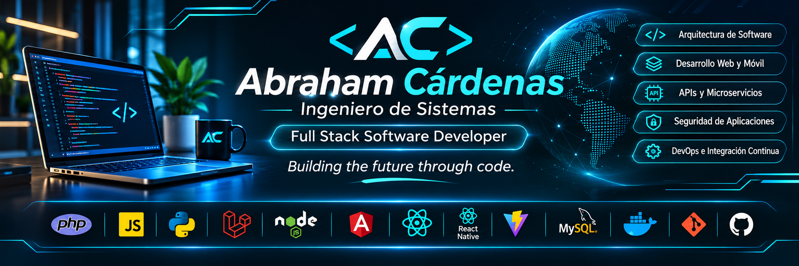

## Hi there 👋

<!--
**abraham-cardenas/abraham-cardenas** is a ✨ _special_ ✨ repository because its `README.md` (this file) appears on your GitHub profile.

Here are some ideas to get you started:

- 🔭 I’m currently working on ...
- 🌱 I’m currently learning ...
- 👯 I’m looking to collaborate on ...
- 🤔 I’m looking for help with ...
<!-- HEADER -->

  

---

## 👨‍💻 About me | Sobre mí

🇨🇴 Ingeniero de sistemas colombiano y desarrollador de software. Actualmente curso una especialización en Desarrollo de Software en la Universidad de Asturias.

Cuento con experiencia en el desarrollo y mantenimiento de aplicaciones institucionales en el DANE, con interés en arquitectura de software, seguridad y soluciones empresariales.

🌎 Colombian Systems Engineer and Software Developer, currently pursuing a postgraduate specialization in Software Development at Universidad de Asturias.

Experienced in developing and maintaining institutional applications at DANE, with interests in software architecture, security and enterprise solutions.

---

## 💼 Professional experience | Experiencia profesional

### 🏛️ DANE — Software Developer / Contractor

- Web application development and maintenance.
- Desarrollo y mantenimiento de aplicaciones web.
- Business logic and data validation.
- Reglas de negocio y validación de datos.
- Database management and data processing.
- Gestión de bases de datos y procesamiento de información.
- Functional testing and framework upgrades.
- Pruebas funcionales y actualización de frameworks.

---

## ⚡ Tech stack | Tecnologías

### 💻 Programming languages

  

### ⚙️ Backend development

  
  

### 🎨 Frontend & Mobile

  

### 🗄️ Databases

  
  

### 🛠️ Development tools

  

### 🏗️ Software engineering

---

## 🚀 Featured projects | Proyectos destacados

| Project | Description | Technologies |
|---|---|---|
| 🚀 ACOVA Tech | Digital solutions initiative / Iniciativa de soluciones digitales | Web & Mobile |
| 🎓 UES University Management | Academic backend project / Proyecto académico de gestión universitaria | Node.js, Adapter, Observer |
| 🏛️ Institutional Applications | Professional experience / Experiencia profesional en sistemas institucionales | PHP, CodeIgniter, MySQL |

---

## 🎓 Education | Formación académica

- 🎓 Systems Engineering / Ingeniería de Sistemas.
- 📚 Postgraduate specialization in Software Development / Especialización en Desarrollo de Software.
- 🏫 Universidad de Asturias.
- 📖 In progress / En curso.

---

## 🎯 Current focus | Enfoque actual

- Software architecture / Arquitectura de software.
- REST APIs and backend development / APIs REST y desarrollo backend.
- Design patterns / Patrones de diseño.
- SOLID principles and Clean Code / Principios SOLID y código limpio.
- Application security / Seguridad de aplicaciones.
- Enterprise software solutions / Soluciones empresariales.

---

## 📊 GitHub Analytics

### 🔥 Contribution streak

### 📈 Contribution activity

---

## 🤝 Let's connect | Conectemos

---

### 💡 Building the future through code.

*Construyendo el futuro a través del código.*

- 💬 Ask me about ...
- 📫 How to reach me: ...
- 😄 Pronouns: ...
- ⚡ Fun fact: ...
-->
